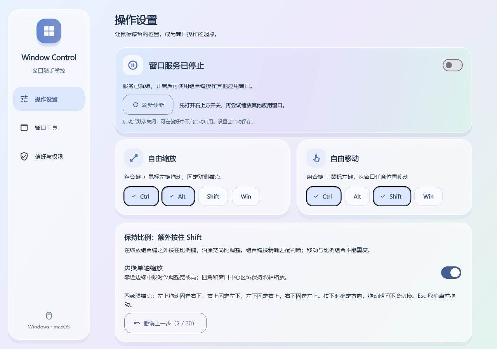
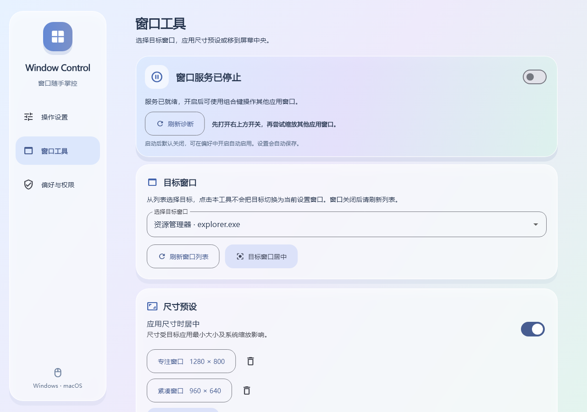

# Window Control

**按住快捷键，从窗口任意位置拖动，就能缩放或移动。**

面向 Windows 的桌面窗口工具。无需寻找细小的边框或标题栏，使用自定义组合键与鼠标即可调整窗口，并提供尺寸预设、居中、多步撤销和应用排除。界面采用大圆角、柔和渐变与半透明面板。

[下载安装包](https://github.com/haoyuanwu/window_control/releases/latest) · [全部版本](https://github.com/haoyuanwu/window_control/releases) · [问题反馈](https://github.com/haoyuanwu/window_control/issues)

> 当前发布 Windows x64 版本。仓库包含 macOS 原生实现，但尚未在 Mac 编译和验证，不提供 macOS 安装包。



## 功能

| 功能 | 使用方式 |
| --- | --- |
| 任意位置缩放 | 在窗口内容区按住组合键拖动，固定对侧角调整大小 |
| 任意位置移动 | 不用寻找标题栏；开始移动时将目标窗口带到前景，不改变永久置顶状态 |
| 保持比例 | 缩放时额外按住 Shift；自定义组合已包含 Shift 时改用 Alt |
| 边缘单轴缩放 | 靠近窗口边缘中段只调整宽度或高度；角落和中心区域双轴调整 |
| 尺寸预设与居中 | 选择目标窗口，一键应用自定义宽高或移动到屏幕中央 |
| 多步撤销 | 撤销最近最多 20 次窗口操作，Esc 取消当前拖动 |
| 应用排除 | 按 exe 文件名排除游戏、绘图工具或其他不需要接管的应用 |
| 窗口记忆 | 记住本工具完成的调整，在识别到同应用类别的新窗口时恢复 |
| 托盘常驻 | 关闭设置后继续运行，从托盘显示设置、启停服务、撤销或退出 |
| 启动设置 | 登录启动与启动后自动启用分别控制，默认均关闭 |

不包含分屏贴靠或屏幕边缘吸附。

## 安装与开始使用

1. 在 [Releases](https://github.com/haoyuanwu/window_control/releases/latest) 下载 `WindowControl-Setup-1.1.0-Windows-x64.exe`。
2. 退出旧版，包括系统托盘中的进程，再运行安装包。默认安装到当前用户目录，无需管理员权限；可选创建桌面快捷方式，并提供标准卸载入口。
3. 启动后打开右上角的窗口服务开关。
4. 在其他应用的普通、非最大化窗口中使用以下操作：

| 默认组合 | 操作 |
| --- | --- |
| Ctrl + Alt + 鼠标左键拖动 | 自由缩放 |
| Ctrl + Shift + 鼠标左键拖动 | 自由移动 |
| Ctrl + Alt + Shift + 鼠标左键拖动 | 保持原宽高比缩放 |
| Esc | 取消当前手势 |

快捷键可在操作设置中多选。三种模式必须使用不同组合；为比例模式预留 Shift 或 Alt，界面会提示冲突。

**关闭窗口默认隐藏到托盘。完全结束程序请在托盘菜单选择“退出”。** 登录启动、自动启用和窗口记忆均须自行打开。安装器不会代替你开启这些选项。

也可以下载单文件便携版 `WindowControl-1.1.0-Portable-Windows-x64.exe`，双击自动释放资源并启动；首次释放可能稍慢。若启用登录启动，请将便携 EXE 放在固定位置后再开启该选项。安装版和便携版共享用户配置。

## 窗口工具



先刷新窗口列表并选择目标，再点击预设或居中；点击本工具不会把目标替换为设置窗口。尺寸预设支持新增与删除，窗口标题较长时会自动省略显示。尺寸受目标应用最小/最大限制及屏幕工作区影响。

## 偏好与边界

- Windows 10 / 11 x64；跨显示器与混合 DPI 仍需结合实际环境验证。
- 普通权限进程不保证控制管理员权限或系统保护窗口；不支持桌面、最小化、最大化、不可缩放及部分特殊窗口。
- 窗口记忆只学习本工具完成的操作，按 exe + 窗口类共享最近的几何信息，不是每个文档独立记忆；同类新窗口可能恢复到相同位置。关闭记忆或暂停服务后停止自动恢复。
- 操作设置中的“刷新诊断”可查看输入匹配、目标窗口和原生错误信息。反馈问题时请附 Windows 版本、目标应用、显示缩放比例和诊断文字。
- 安装包与程序目前未做代码签名。软件不包含在线服务功能；运行配置与窗口记忆保存在本机用户目录。
- macOS 实现需要辅助功能与输入监控权限；已按独立分发配置关闭 App Sandbox。登录启动使用 macOS 13+ SMAppService，仍待 Apple SDK 编译、真机操作及签名、公证验证。

## 开发与打包

环境：Flutter 3.47.7 / Dart 3.13.5 或满足 pubspec 约束的兼容版本、Visual Studio C++ 桌面工具链。构建安装包另需 Inno Setup 6.3+ 或 7。

```powershell
flutter pub get
flutter analyze
flutter test
flutter build windows --release
.\packaging\windows\build-installer.ps1 -SkipBuild
.\packaging\windows\build-single-exe.ps1
```

安装包输出到 `build/releases/`，便携启动器输出到 `build/WindowControl.exe`。安装包脚本从 Visual Studio 官方 Redist 目录复制应用本地 CRT；也可通过 `-IsccPath` 和 `-RedistPath` 指定构建环境路径。

Windows 原生隔离检查：

```powershell
flutter build windows --debug
cmake -S windows -B build/windows/x64 -DWINDOW_CONTROL_BUILD_NATIVE_TESTS=ON
cmake --build build/windows/x64 --config Debug --target window_control_native_test
.\build\windows\x64\runner\Debug\window_control_native_test.exe
cmake -S windows -B build/windows/x64 -DWINDOW_CONTROL_BUILD_NATIVE_TESTS=OFF
```

macOS 须在 Mac 上执行 `flutter build macos`，Windows 检查不能替代该步骤。

## 验证与文档

扩展版已通过 Flutter 静态检查、14 项 Flutter 测试及 76 项 Windows 受控原生检查。最终受控运行有 2 项真实系统输入检查受桌面环境限制而跳过；这些数字不代表所有第三方应用、托盘交互、真实登录启动或 macOS 已完成验收。

- [完整功能与交互](docs/requirements.md)
- [原生通信协议](docs/native_protocol.md)
- [验收记录和待验证项](docs/acceptance.md)
- [第三方组件说明](docs/THIRD_PARTY_NOTICES.md)
